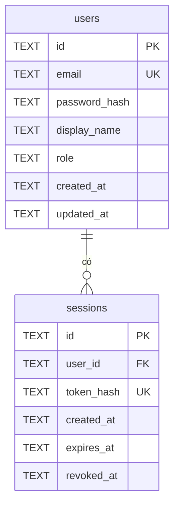

# Mô hình dữ liệu tài khoản (T01 / BOOK-29)

Schema local nằm ở [`db/migrations/0001_accounts.sql`](../db/migrations/0001_accounts.sql), dùng cú pháp SQLite tương thích Cloudflare D1.

- `users.email` duy nhất và so sánh không phân biệt chữ hoa/thường (BR01). API cần chuẩn hóa bằng cách `trim` và chuyển chữ thường trước khi lưu; không đưa email trống vào database.
- API đăng ký chỉ tạo `role = 'customer'`. Tài khoản `admin` phải được cấp riêng, không nhận role từ request đăng ký.
- `password_hash` chứa mã băm mật khẩu có salt theo thuật toán phù hợp; không lưu mật khẩu gốc.
- `sessions.token_hash` chứa mã băm của token phiên ngẫu nhiên. Chỉ gửi token gốc cho trình duyệt lúc tạo phiên; không lưu token gốc trong database.
- API chỉ chấp nhận phiên khi `revoked_at IS NULL` và `expires_at > thời điểm hiện tại`. Đăng xuất đặt `revoked_at`; kiểm tra quyền admin tại API bằng `users.role` (BR02).
- ID của cả hai bảng do API tạo, ví dụ UUID. Thời gian lưu dạng UTC ISO 8601. Bật `PRAGMA foreign_keys = ON` cho kết nối SQLite local.
- Bảng đơn hàng của nhóm sẽ tham chiếu `users.id` để giới hạn khách chỉ đọc đơn của mình. Chưa định nghĩa bảng đơn trong migration tài khoản để tránh chồng lấn phần việc của thành viên khác.

Chạy local: `sqlite3 booknest.db ".read db/migrations/0001_accounts.sql"`.
