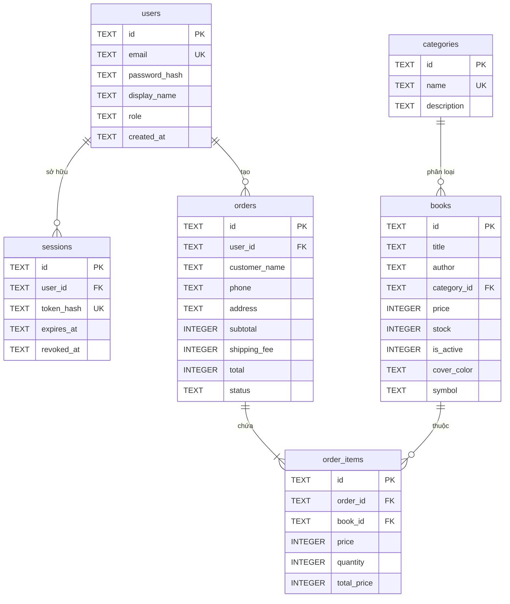
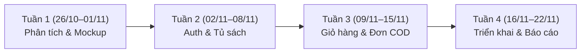

# BÁO CÁO MINI PROJECT MÔN ĐIỆN TOÁN ĐÁM MÂY

**ĐỀ TÀI: XÂY DỰNG VÀ TRIỂN KHAI WEBSITE BÁN SÁCH TRỰC TUYẾN BOOKNEST TRÊN NỀN TẢNG CLOUDFLARE WORKERS VÀ CLOUDFLARE D1**

* **Nhóm sinh viên thực hiện**:
  1. **Trần Văn Nhu** — Mã SV: DTC235200572 (Nhóm trưởng)
  2. **Nông Minh Phương**
  3. **Hoàng Duy Hạnh**
* **Kho lưu trữ mã nguồn**: [https://github.com/nongphuonge-glitch/Booknest.git](https://github.com/nongphuonge-glitch/Booknest.git)

---

## MỤC LỤC BÁO CÁO (07 PHẦN CHÍNH)

1. [Phần 1: Mô tả bài toán và phân tích thiết kế hệ thống](#phần-1-mô-tả-bài-toán-và-phân-tích-thiết-kế-hệ-thống)
2. [Phần 2: Dịch vụ Cloud được lựa chọn và phân tích tính hợp lý](#phần-2-dịch-vụ-cloud-được-lựa-chọn-và-phân-tích-tính-hợp-lý)
3. [Phần 3: Phân công công việc trong nhóm](#phần-3-phân-công-công-việc-trong-nhóm)
4. [Phần 4: Kế hoạch triển khai và tiến độ thực tế (4 tuần)](#phần-4-kế-hoạch-triển-khai-và-tiến-độ-thực-tế-4-tuần)
5. [Phần 5: Các bước chi tiết triển khai lên Cloudflare Workers & D1](#phần-5-các-bước-chi-tiết-triển-khai-lên-cloudflare-workers--d1)
6. [Phần 6: Kết quả sau triển khai và hướng dẫn sử dụng sản phẩm](#phần-6-kết-quả-sau-triển-khai-và-hướng-dẫn-sử-dụng-sản-phẩm)
7. [Phần 7: Kết luận và hướng phát triển](#phần-7-kết-luận-và-hướng-phát-triển)

---

## PHẦN 1: MÔ TẢ BÀI TOÁN VÀ PHÂN TÍCH THIẾT KẾ HỆ THỐNG

### 1.1. Bối cảnh và bài toán giải quyết
Trong thời đại chuyển đổi số, thói quen mua sắm trực tuyến phát triển mạnh mẽ. Tuy nhiên, việc vận hành một website thương mại điện tử truyền thống thường đòi hỏi chi phí hạ tầng máy chủ (Server/VPS) cố định, công tác bảo trì phức tạp và khó mở rộng quy mô khi lượng người truy cập tăng đột biến. 

Dự án **BookNest** ra đời nhằm giải quyết bài toán:
* Cung cấp nền tảng bán sách trực tuyến gọn nhẹ, tối ưu trải nghiệm cho **Khách hàng** (tìm kiếm, xem chi tiết, giỏ hàng, đặt mua giao hàng nhận tiền COD) và **Quản trị viên** (quản lý danh mục sách, cập nhật tồn kho, xử lý đơn hàng).
* Ứng dụng mô hình kiến trúc **Serverless Computing** hiện đại trên nền tảng đám mây công cộng (Public Cloud), giúp loại bỏ chi phí máy chủ nhàn rỗi, tự động mở rộng theo nhu cầu (auto-scaling) và đảm bảo an toàn dữ liệu.

### 1.2. Input, Output và Nội hàm nghiệp vụ
* **Đầu vào (Input)**:
  * Thông tin tài khoản người dùng (Email, mật khẩu, tên hiển thị).
  * Danh mục sách (Tiêu đề, tác giả, thể loại, đơn giá, số lượng tồn kho ban đầu, trạng thái ẩn/hiện).
  * Thao tác giỏ hàng (Số lượng đặt mua cho từng cuốn sách).
  * Thông tin đặt hàng COD (Họ tên người nhận, số điện thoại, địa chỉ giao hàng, ghi chú).
* **Đầu ra (Output)**:
  * Danh mục sách đang mở bán kèm bộ lọc và tìm kiếm thời gian thực.
  * Tạm tính tiền sách và tính toán phí vận chuyển tự động (Miễn phí từ 300.000đ; dưới 300.000đ thu 25.000đ).
  * Mã đơn hàng duy nhất (`BN-XXXXXX`), trạng thái đơn và lịch sử mua hàng cá nhân.
  * Bảng điều khiển quản trị (Thống kê số lượng đơn hàng, đơn chờ xác nhận, doanh thu hoàn thành, điều chỉnh tồn kho tức thời).
* **Nội hàm bài toán (Core Business Rules)**:
  * `BR01 (Email duy nhất)`: Mỗi địa chỉ email chỉ đăng ký được 1 tài khoản khách hàng duy nhất.
  * `BR02 (Giới hạn quyền nghiêm ngặt)`: Khách hàng chỉ xem được đơn hàng của chính mình. Toàn bộ API và giao diện quản trị (`admin`) bắt buộc phải kiểm tra quyền tại server.
  * `BR03 (Sách đang bán)`: Khách hàng chỉ có thể tìm thấy, thêm vào giỏ và đặt mua những cuốn sách có trạng thái `is_active = 1`.
  * `BR04 (Kiểm tra tồn kho & Giao dịch nguyên tử)`: Đặt mua và trừ tồn kho diễn ra trong cùng một transaction. Tuyệt đối không cho phép tồn kho âm.
  * `BR05 (Tính tiền phía máy chủ)`: Toàn bộ đơn giá và phí ship được tính toán tại Server, không tin tưởng giá trị gửi lên từ trình duyệt.

### 1.3. Mô hình Thực thể - Liên kết (ERD Tổng thể)

Hệ thống được chuẩn hóa trên CSDL SQLite/D1 gồm 5 bảng quan hệ chặt chẽ:



---

## PHẦN 2: DỊCH VỤ CLOUD ĐƯỢC LỰA CHỌN VÀ PHÂN TÍCH TÍNH HỢP LÝ

### 2.1. Giới thiệu dịch vụ Cloudflare Workers & Cloudflare D1
Sau khi khảo sát các nhà cung cấp dịch vụ đám mây, nhóm quyết định lựa chọn **Cloudflare** với bộ đôi dịch vụ:
1. **Cloudflare Workers**: Nền tảng Serverless Execution Environment chạy mã nguồn TypeScript/JavaScript trên mạng lưới toàn cầu (Edge Network) gồm hơn 330 trung tâm dữ liệu. Workers khởi động ngay lập tức (Cold start 0ms nhờ công nghệ V8 Isolates), xử lý toàn bộ RESTful API và xác thực.
2. **Cloudflare D1**: Cơ sở dữ liệu quan hệ Serverless SQL đầu tiên của Cloudflare dựa trên lõi SQLite, cung cấp khả năng lưu trữ quan hệ với ACID transaction, độ trễ cực thấp và tương thích hoàn hảo với Workers.

### 2.2. Giao diện và tính năng sau khi đăng nhập tài khoản Cloudflare
Sau khi đăng nhập vào [dash.cloudflare.com](https://dash.cloudflare.com), giao diện quản lý cung cấp:
* **Workers & Pages**: Quản lý các worker scripts, xem URL production, biến môi trường (Environment Variables), secrets và theo dõi số lượng requests/giây, CPU time, error rate.
* **D1 Databases**: Tạo database, xem thông số `database_id`, giao diện Console thực thi câu lệnh SQL trực tiếp trên trình duyệt, quản lý migrations và backup bản ghi.
* **Live Logs**: Trình xem log thời gian thực (`wrangler tail`) giúp giám sát hoạt động API và debug lỗi tức thì.

### 2.3. Tính hợp lý và kiểm soát chi phí (Tránh phát sinh phí thẻ)
* **Phù hợp với bài toán**: BookNest là ứng dụng thương mại điện tử cần phản hồi nhanh, dữ liệu có cấu trúc quan hệ (users, books, orders) và cần bảo toàn tính nhất quán khi đặt hàng trừ kho. Workers kết hợp D1 là kiến trúc lý tưởng nhất.
* **Kiểm soát chi phí chặt chẽ**:
  * Cloudflare cung cấp gói **Free Tier hoàn toàn miễn phí mà không bắt buộc nhập thẻ tín dụng (No credit card required)**.
  * Hạn mức miễn phí rất rộng rãi:
    * **Workers Free**: 100.000 requests/ngày (hoàn toàn dư dả cho nhu cầu chạy thử nghiệm và nộp bài).
    * **D1 Free**: 5.000.000 rows đọc/ngày, 100.000 rows ghi/ngày, dung lượng 5 GB.
  * Vì không bắt buộc gắn thẻ quốc tế nên nhóm **hoàn toàn loại bỏ rủi ro phát sinh phí ngoài ý muốn**, tuân thủ đúng khuyến cáo của giảng viên.

---

## PHẦN 3: PHÂN CÔNG CÔNG VIỆC TRONG NHÓM

Dự án được phân chia khối lượng đồng đều cho 3 thành viên theo đúng thế mạnh và vai trò kỹ thuật:

| Thành viên | Vai trò | Trách nhiệm chính | Sản phẩm đầu ra |
| :--- | :--- | :--- | :--- |
| **Trần Văn Nhu** *(Nhóm trưởng)* | Kiến trúc sư Backend & Tích hợp Cloud | - Thiết kế kiến trúc tổng thể, ERD và Git Flow.<br>- Phát triển API xác thực, phiên bảo mật (`auth.ts`).<br>- Cấu hình Worker, Cloudflare D1 binding, xử lý deploy.<br>- Viết Báo cáo Phần 1, 2, 5. | - `backend/src/auth.ts`<br>- `backend/wrangler.jsonc`<br>- File cấu hình D1 & tài liệu Git Flow |
| **Nông Minh Phương** | Kỹ sư Giao diện Frontend | - Thiết kế UI/UX hiện đại trên React 19 + Vite + TypeScript.<br>- Xây dựng giao diện Tủ sách, tìm kiếm, lọc thể loại (`BookCatalog.tsx`).<br>- Hoàn thiện Giỏ sách (`Cart.tsx`) và Modal đặt hàng COD (`CheckoutModal.tsx`).<br>- Soạn slide thuyết trình và hướng dẫn sử dụng (Phần 6). | - `frontend/src/components/`<br>- `frontend/src/styles.css`<br>- Slide thuyết trình buổi demo |
| **Hoàng Duy Hạnh** | Kỹ sư Dữ liệu & Quản trị | - Chuẩn bị bộ dữ liệu 18 sách mẫu thuộc 6 thể loại.<br>- Phát triển API và giao diện quản trị sách, cập nhật tồn kho (`AdminBooks.tsx`).<br>- Xây dựng API duyệt đơn hàng COD và đối soát kho (`AdminOrders.tsx`).<br>- Ghép và chuẩn hóa báo cáo 20 trang (Phần 3, 4, 7). | - `backend/db/migrations/`<br>- `backend/src/orders.ts`<br>- Báo cáo hoàn chỉnh nộp bài |

---

## PHẦN 4: KẾ HOẠCH TRIỂN KHAI VÀ TIẾN ĐỘ THỰC TẾ (4 TUẦN)

Nhóm áp dụng mô hình Agile/Scrum rút gọn theo 4 Sprint tương ứng với 4 tuần:



* **Tuần 1 (26/10 – 01/11/2026)**:
  * Khảo sát yêu cầu môn học, lập bảng User Stories và phân công tasks trên Jira (BOOK-3, BOOK-4, BOOK-5).
  * Thiết kế kiến trúc hệ thống, ERD CSDL và xây dựng prototype giao diện sơ bộ.
* **Tuần 2 (02/11 – 08/11/2026)**:
  * Tách cấu trúc repo theo chuẩn (`backend`, `frontend`, `docs`).
  * Hoàn thành Epic E1 (Tài khoản & phân quyền, băm mật khẩu PBKDF2).
  * Xây dựng CSDL D1 migration `0002_books.sql` với 18 cuốn sách mẫu.
* **Tuần 3 (09/11 – 15/11/2026)**:
  * Hoàn thiện Epic E2 & E3: API & UI Danh mục, lọc thể loại, giỏ sách, quản lý tồn kho admin.
  * Hoàn thiện Epic E4: CSDL `0003_orders.sql`, API đặt hàng COD, trừ tồn kho trong cùng giao dịch D1 batch, trang theo dõi đơn hàng của khách và trang duyệt đơn admin.
* **Tuần 4 (16/11 – 22/11/2026)**:
  * Tích hợp toàn diện luồng nghiệp vụ trên local, kiểm thử nghiệm thu AC01 ➔ AC10.
  * Soạn thảo tài liệu hướng dẫn deploy Cloudflare và bộ báo cáo hoàn chỉnh.

---

## PHẦN 5: CÁC BƯỚC CHI TIẾT TRIỂN KHAI LÊN CLOUDFLARE WORKERS & D1

Quy trình deploy được thực hiện hoàn toàn tự động thông qua công cụ dòng lệnh **Wrangler CLI** do Cloudflare cung cấp:

### Bước 1: Đăng nhập Cloudflare từ CLI
```bash
npx wrangler login
```
*Trình duyệt sẽ tự động mở trang xác thực Cloudflare. Bấm **Allow** để cấp quyền cho Wrangler.*
*(Chèn hình ảnh: Giao diện cấp quyền Wrangler trên trình duyệt)*

### Bước 2: Tạo Cơ sở dữ liệu D1 trên Cloudflare
```bash
npx wrangler d1 create booknest
```
Lệnh trên sẽ trả về thông tin Database ID, ví dụ:
```text
✅ Successfully created DB 'booknest'
database_id: "c82b94a1-4321-4def-9876-123456789abc"
```
Cập nhật `database_id` thật này vào file `backend/wrangler.jsonc`.
*(Chèn hình ảnh: Màn hình tạo D1 thành công trên Terminal và giao diện D1 Database trên Cloudflare Dashboard)*

### Bước 3: Áp dụng CSDL và nạp dữ liệu mẫu lên Cloudflare D1
Chạy lần lượt các migrations phiên bản lên cloud:
```bash
cd backend
npx wrangler d1 migrations apply booknest --remote
```
Hệ thống sẽ chạy liên tiếp 3 file:
1. `0001_accounts.sql` (bảng `users`, `sessions`)
2. `0002_books.sql` (bảng `categories`, `books` và nạp 18 sách mẫu)
3. `0003_orders.sql` (bảng `orders`, `order_items` và nạp đơn hàng demo)
*(Chèn hình ảnh: Console Cloudflare D1 hiển thị các bảng đã tạo và dữ liệu sách)*

### Bước 4: Deploy mã nguồn Backend API Worker lên Cloudflare
```bash
cd backend
npm run deploy
```
Wrangler sẽ biên dịch TypeScript, bundle mã nguồn và đẩy lên mạng lưới Edge của Cloudflare. Kết quả trả về URL công khai:
```text
Uploaded booknest-api (1.20 sec)
Deployed booknest-api triggers:
  https://booknest-api.tranvannhu01.workers.dev
```
*(Chèn hình ảnh: Kết quả deploy Worker thành công kèm đường dẫn URL)*

### Bước 5: Deploy Frontend lên Cloudflare Pages
```bash
cd frontend
npm run build
npx wrangler pages deploy dist --project-name booknest-web
```
Trang web tĩnh sẽ được phân phối toàn cầu và kết nối trực tiếp với Worker API qua endpoint `/api`.
*(Chèn hình ảnh: Giao diện Cloudflare Pages hiển thị trạng thái Active)*

---

## PHẦN 6: KẾT QUẢ SAU TRIỂN KHAI VÀ HƯỚNG DẪN SỬ DỤNG SẢN PHẨM

### 6.1. Các tính năng và giao diện chính

1. **Giao diện Tủ sách (Khám phá)**:
   * Hiển thị lưới sách trực quan với bìa nghệ thuật, ký hiệu đặc trưng và màu sắc bìa đồng bộ.
   * Thanh tìm kiếm thời gian thực theo tên sách hoặc tác giả.
   * Bộ lọc theo 6 thể loại (Đời sống, Tâm lý, Văn học, Kinh doanh, Thiếu nhi, Công nghệ).
   * Lựa chọn sắp xếp giá: Đề xuất, Giá tăng dần, Giá giảm dần.
   * Modal xem chi tiết sách: Hiển thị mô tả, đơn giá và số lượng tồn kho còn lại.
2. **Giao diện Giỏ sách & Tính phí thông minh**:
   * Tăng / giảm số lượng sách với giới hạn tối đa theo tồn kho thực tế.
   * Tự động tính toán tổng tiền và áp dụng quy tắc `BR05`: Đơn từ 300.000đ trở lên được **Miễn phí giao hàng**; dưới 300.000đ áp dụng phí 25.000đ.
3. **Giao diện Đặt hàng COD (Thanh toán khi nhận hàng)**:
   * Form điền thông tin người nhận: Họ tên, số điện thoại, địa chỉ chi tiết và ghi chú.
   * Cơ chế kiểm tra tồn kho tại server: Nếu kho không đủ, báo lỗi chi tiết và giữ nguyên kho. Khi hợp lệ, tạo đơn và trừ tồn kho ngay lập tức.
4. **Giao diện Theo dõi đơn hàng cá nhân**:
   * Khách hàng xem lại các đơn đã đặt, thời gian đặt, chi tiết từng cuốn sách và badge trạng thái thời gian thực.
5. **Giao diện Quản trị viên (Admin Dashboard)**:
   * **Quản lý tủ sách**: Form thêm sách mới, bảng sửa số lượng tồn kho trực tiếp (chặn số âm theo `BR04`), nút toggle "Ẩn sách" / "Bật bán".
   * **Quản lý đơn hàng**: Thống kê số lượng đơn, đơn chờ duyệt, doanh thu hoàn thành; dropdown cập nhật tiến độ đơn hàng (`Chờ xác nhận` ➔ `Đã xác nhận` ➔ `Đang giao` ➔ `Hoàn thành` / `Đã hủy` - tự động hoàn kho khi hủy).

### 6.2. Hướng dẫn sử dụng thử nghiệm (Kịch bản Demo)
1. Truy cập vào trang web, chọn tab **Tài khoản** để đăng ký tài khoản mới hoặc đăng nhập.
2. Sang tab **Khám phá**, gõ tìm kiếm cuốn sách mong muốn (ví dụ "Những ngày chậm rãi"), bấm dấu `+` để thêm vào giỏ.
3. Mở tab **Giỏ sách**, điều chỉnh số lượng cuốn và bấm **Tiến hành đặt hàng COD**.
4. Điền địa chỉ giao hàng và xác nhận. Sau khi đặt thành công, hệ thống tự động chuyển sang tab **Đơn hàng** để xem mã đơn mới tạo.
5. Đăng nhập tài khoản Quản trị viên (`role = 'admin'`), mở tab **Quản lý đơn** để duyệt đơn sang trạng thái `Đã xác nhận`.

---

## PHẦN 7: KẾT LUẬN VÀ HƯỚNG PHÁT TRIỂN

### 7.1. Kết luận
* Nhóm đã hoàn thành toàn diện mục tiêu của mini-project môn Điện toán đám mây: Xây dựng một sản phẩm hoàn chỉnh sau quá trình phân tích thiết kế hệ thống nghiêm túc, không sử dụng template tĩnh đơn giản.
* Ứng dụng thành công công nghệ Serverless hiện đại (**Cloudflare Workers + D1**), kiểm soát 100% chi phí với gói Free Tier an toàn không cần thẻ tín dụng.
* Quy trình phát triển tuân thủ chặt chẽ mô hình **Git Flow**, phân công công việc cân đối giữa 3 thành viên và lưu trữ lịch sử commit nguyên tử trên GitHub.

### 7.2. Hướng phát triển trong tương lai
* **Tích hợp Cổng thanh toán trực tuyến**: Tích hợp VNPay / MoMo qua webhook xử lý thanh toán tự động.
* **Thông báo qua Email / SMS**: Kết hợp Cloudflare Queues và dịch vụ Resend / Twilio để gửi email xác nhận đơn hàng tự động cho khách.
* **Gợi ý sách thông minh bằng AI**: Sử dụng Cloudflare Workers AI (mô hình Llama-3 / BGE Embeddings) để xây dựng hệ thống gợi ý sách dựa trên thói quen đọc của người dùng.
