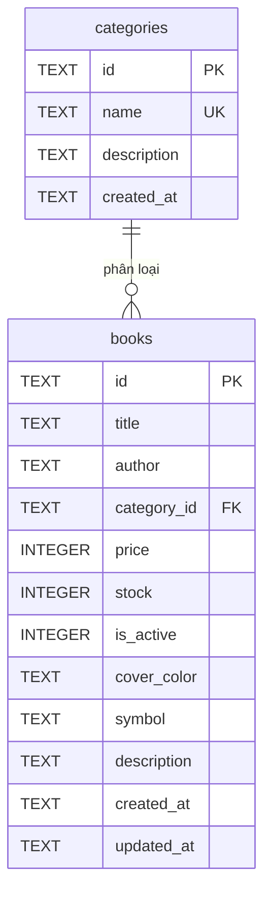

# Mô hình dữ liệu sách và danh mục (T09, US03, US05, US06)

Schema local và migration D1 nằm tại [`backend/db/migrations/0002_books.sql`](../backend/db/migrations/0002_books.sql).

## Các quy tắc nghiệp vụ liên quan

1. **BR03 (Sách đang bán)**: Chỉ những cuốn sách có `is_active = 1` mới được hiển thị trong API công khai (`/api/books`) và cho phép đưa vào giỏ hàng hoặc đặt đơn.
2. **BR04 (Kiểm tra tồn kho)**: `stock >= 0` được ràng buộc chặt chẽ bằng `CHECK (stock >= 0)` trong schema. Bất kỳ thao tác cập nhật số âm nào từ admin hoặc khi đặt đơn vượt quá tồn kho đều bị từ chối.
3. **18 cuốn sách mẫu (T09)**: Bao gồm 6 thể loại chính (Đời sống, Tâm lý, Văn học, Kinh doanh, Thiếu nhi, Công nghệ) và 1 cuốn sách ẩn (`b18` với `is_active = 0`) phục vụ kiểm thử nghiệm thu AC05.
