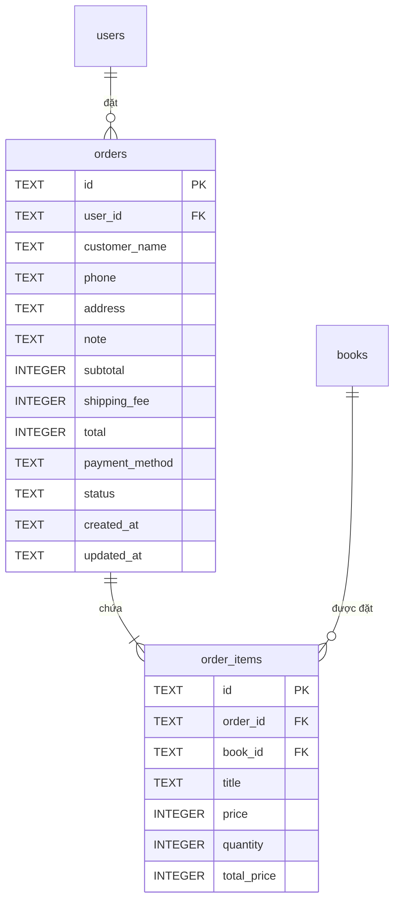

# Mô hình dữ liệu Đơn hàng COD (US07, US08 / T13, T14, T16)

Schema local và migration D1 nằm tại [`backend/db/migrations/0003_orders.sql`](../backend/db/migrations/0003_orders.sql).

## Các quy tắc nghiệp vụ liên quan (Business Rules)

1. **BR02 (Giới hạn quyền)**:
   * Khách hàng đăng nhập chỉ xem được các đơn hàng có `orders.user_id` trùng với tài khoản của mình qua endpoint `/api/orders/my`.
   * Quản trị viên (`role = 'admin'`) có toàn quyền xem tất cả các đơn qua `/api/admin/orders` và duyệt đổi trạng thái qua `/api/admin/orders/:id/status`.
2. **BR04 (Kiểm tra tồn kho & Giao dịch nguyên tử)**:
   * Khi tạo đơn hàng, hệ thống kiểm tra số lượng yêu cầu so với `books.stock`. Nếu không đủ hàng, toàn bộ đơn bị từ chối và kho giữ nguyên.
   * Việc ghi đơn vào `orders`, `order_items` và trừ kho trong `books` được thực hiện đồng thời trong cùng một batch giao dịch D1 (`env.DB.batch(...)`).
3. **BR05 (Tính tiền phía máy chủ)**:
   * Bỏ qua hoàn toàn giá tiền gửi từ client. Máy chủ tự truy vấn đơn giá thực tế trong bảng `books` tại thời điểm đặt đơn.
   * Tự động tính phí vận chuyển:
     * Nếu `subtotal < 300.000đ` -> `shipping_fee = 25.000đ`.
     * Nếu `subtotal >= 300.000đ` -> `shipping_fee = 0đ` (Miễn phí vận chuyển toàn quốc).
     * `total = subtotal + shipping_fee`.
